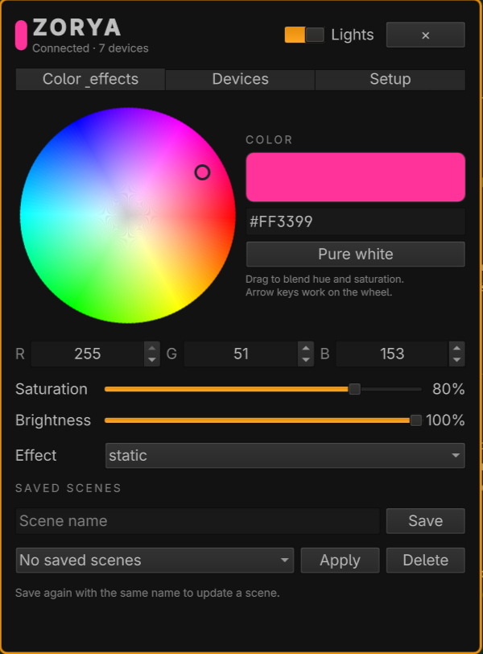

# ZoryaRGB for Omarchy

Named after Zorya, the dawn figure in Slavic folklore.



A native Omarchy Quattro plugin for choosing colors, saving lighting scenes, and recovering them after suspend. Built for OpenRGB and supported Lian Li wireless controllers.

## Features

- HSV color wheel, saturation, brightness, HEX and RGB inputs, and a dedicated white button.
- Static, pulse, rainbow and two-color gradient effects with adjustable speed.
- Named saved presets and explicit device selection.
- A local daemon that keeps hardware work out of the Omarchy shell, reconnects devices and restores the active scene after actual suspend.
- Hardware diagnosis and explicit setup for OpenRGB, Lian Li wireless and Kingston DDR5 detection compatibility.
- Migration from the existing RGB plugin and adoption of compatible user services with rollback information.

Zorya runs inside the existing Omarchy shell. Hardware tools run as separate user services. Installation of system dependencies and USB access rules is a separate setup action; it is never triggered by opening the panel.

## Install

```sh
omarchy plugin add https://github.com/VonderVuflya/omarchy-zorya-rgb.git --enable
```

Open **ZoryaRGB → Setup**. The panel checks what is ready without changing your system. Review the required steps, then select **Start setup** to prepare the private runtime and supported hardware services. Setup may request system authorization for packages or USB/I2C permissions; builds can take several minutes. It keeps working when you close the panel. If a step fails, its error remains visible and **Retry setup** checks which stages are still needed.

After connection verification, open **Choose devices**, select the targets you want, and explicitly apply your chosen color to check the lighting. Discovery alone does not prove that every physical LED responds.

Alternatively, install from a checkout:

```sh
./bin/zorya-rgb install
```

The runtime installer creates a private Python environment, installs `openrgb-python`, registers the user daemon and installs the panel. Select the devices you want Zorya to control. An empty selection means **no devices**, not all devices.

To import the old RGB plugin's selected devices and color:

```sh
zorya-rgb migrate
```

## Hardware setup

The guided Setup reuses working local SDK services without replacing or restarting them. Detailed diagnostics, pairing and optional Kingston compatibility setup are available under **Advanced tools**. The existing CLI remains available for explicit component setup:

```sh
zorya-rgb onboarding plan
zorya-rgb doctor
zorya-rgb setup --component all --dry-run
zorya-rgb setup --component openrgb
zorya-rgb setup --component lianli
zorya-rgb setup --component kingston
```

Fresh hardware builds use pinned upstream commits and bundled compatibility patches. Setup may need a polkit password to install build dependencies or narrowly scoped USB/I2C access rules. Downloads and compilation can take several minutes. Linux/Omarchy on Arch is the primary target; dependencies and exact hardware availability are reported before an operation.

The Lian Li adapter defaults to RGB control. It does not set pump speeds, fan curves or LCD media. Existing RGB-only services can be adopted. Setup refuses to replace a full-mode cooling/LCD service, including an older Zorya-managed service, before changing configuration or units. Configure a separate RGB-only bridge explicitly to use it alongside existing cooling control. Unbound devices appear in Setup with an explicit **Pair** action. Pairing is never performed by status polling.

See [hardware support](docs/hardware.md) and [lifecycle and permissions](docs/lifecycle.md).

## Color and effects

Drag the wheel for live color changes, or enter a six-digit color. Drag updates are coalesced every 120 ms and the final color is sent on release. White selects `#FFFFFF`; brightness remains independently adjustable. Select devices in the **Devices** tab. Save a named preset to retain color, brightness, effect, speed and device selection together.

```sh
zorya-rgb status
zorya-rgb devices
zorya-rgb set --json '{"color":"#FFFFFF","brightness":75,"effect":"static"}'
zorya-rgb set --json '{"effect":"pulse","speed":1.2}'
zorya-rgb set --json '{"effect":"gradient","color":"#00E5FF","secondary_color":"#FF3399"}'
zorya-rgb preset save "Evening"
```

Native device modes are used when compatible. Supported Lian Li wireless controllers run pulse from a smooth onboard frame loop with the updated bridge. Software fallback may run at up to 30 FPS for USB/HID devices; SMBus/RF/unknown devices retain a conservative two-FPS limit. Some devices do not offer every mode; unsupported operations are shown as device errors instead of silently pretending to succeed.

## Updates and bug reports

Zorya checks GitHub Releases when the widget loads and every six hours. A newer stable release shows an **↑** button. Open it to review the version, then choose **Install update**. UI and runtime update together from that exact release tag; source backups are retained and a failed runtime health check rolls back. Updates preserve lighting state and hardware configuration. Local git edits block replacement, and releases that change dependencies require explicit Setup instead.

Errors remain available after a transient recovery. Select **Prepare issue report** to review a readable Markdown report containing versions, hardware models, kernel drivers, relevant service states and the error/traceback. Raw JSON Details have been removed. Device identities, credentials and user paths are filtered; review the content before sharing it publicly.

With an authenticated GitHub CLI, **Create GitHub issue** submits the full reviewed report with one explicit click. Zorya never reads your token or publishes on error detection alone. **Open GitHub issue form** and **Copy full report** remain available without gh. Long browser drafts show a truncation notice: copy the full report before submitting. The full report is also useful as input to Codex for reproduction and a regression-tested fix through the normal OpenSpec/PR workflow.

## Remove

```sh
zorya-rgb uninstall
omarchy plugin remove vondervuflya.zorya-rgb
```

Saved Zorya state is retained. Unrelated services and upstream system packages are not removed. Adoption metadata tracks previous user-service state for restoration.

## Develop with OpenSpec

```sh
python -m venv /tmp/zorya-dev
/tmp/zorya-dev/bin/pip install '.[hardware]'
/tmp/zorya-dev/bin/python -m unittest discover -s tests -v
npm ci --ignore-scripts
npm run spec:validate
omarchy plugin validate "$HOME/.config/omarchy/plugins/vondervuflya.zorya-rgb"
python scripts/check-qml.py
```

OpenSpec artifacts live in [openspec/changes/initial-zorya-rgb](openspec/changes/initial-zorya-rgb). See [contribution guidelines](CONTRIBUTING.md). Tests that need Qt/Quickshell skip when those development tools are unavailable; native shell validation is a separate local check.

## License and upstream credits

Zorya's original code is **GPL-3.0-or-later**. `openrgb-python` is GPLv3. OpenRGB compatibility patches retain GPL-2.0-or-later notices; Lian Li patches retain the MIT license. See [third-party notices](THIRD_PARTY_NOTICES.md).
